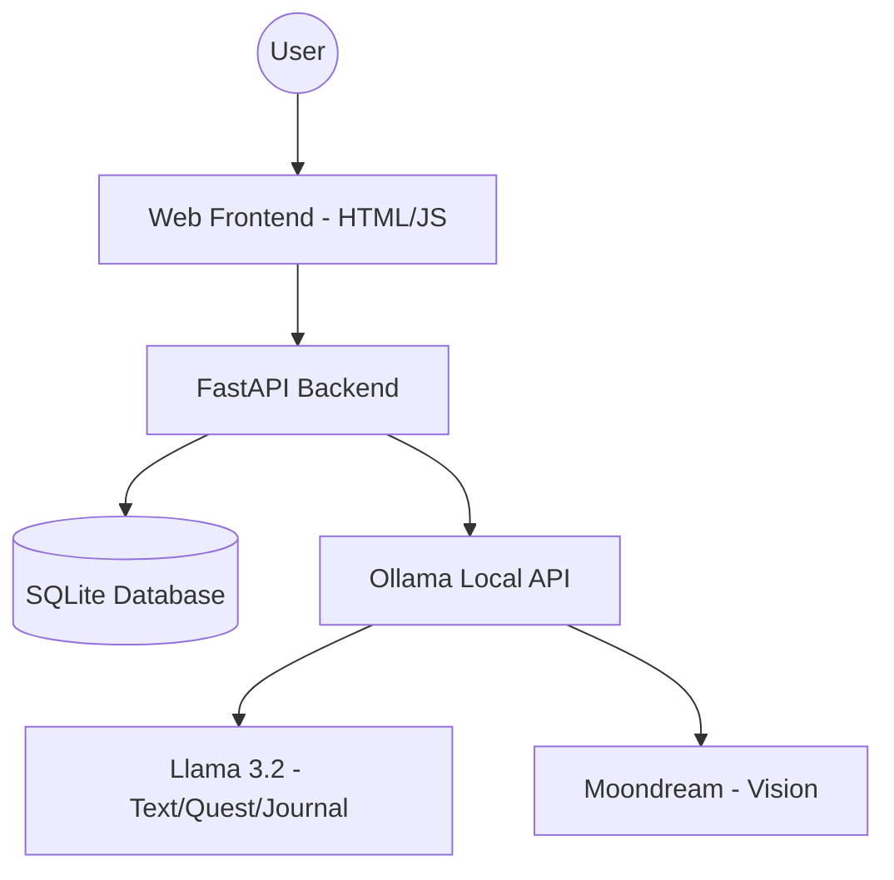

# Architecture

Grass Quest follows a simple, robust architecture focused on local execution and privacy.

## Component Diagram

## Data Flow

1. **Quest Generation:** User input -> FastAPI -> Ollama (Llama 3.2) -> SQLite -> WebUI.
2. **Photo Matching:** Upload -> FastAPI -> Ollama (Moondream) -> Ollama (Llama 3.2) -> SQLite -> WebUI.
3. **Journaling:** Completed Tasks -> FastAPI -> Ollama (Llama 3.2) -> SQLite -> WebUI.
